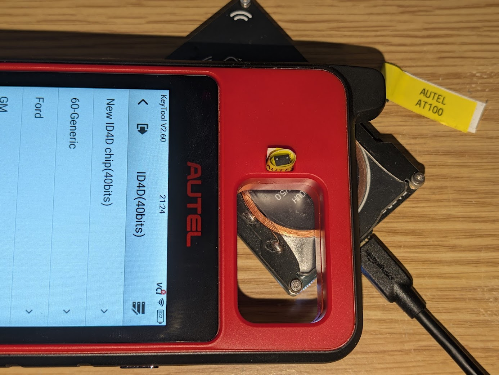

Below is a trace of an Autel programmer identifying an AT100 chip. **Blue** boxes are what the programmer sends, **orange** boxes are what the chip answers. Click the graph, then scroll to zoom; drag to pan; the table below lists every message. Zoom in on any box to see the individual bits sitting on the waveform. Encrypted frames show both the ciphertext on the air and the plaintext recovered with the HITAG2 keystream. Use the drop-down to switch between an identify, a detect, and the programmer setting the chip into six of its emulation modes.

Hopefully by the time you have read this post the plot will make sense to you.

<link rel="stylesheet" href="{{ '/assets/pm3-viewer/viewer.css' | relative_url }}">
<script src="{{ '/assets/pm3-viewer/at100-decoder.js' | relative_url }}" defer></script>
<script src="{{ '/assets/pm3-viewer/viewer.js' | relative_url }}" defer></script>


<div id="fig1" data-trace-viewer data-height="540" data-traces="{{ tb }}autel-at100-read.pm3.gz|Identify / read an AT100 (Autel),
{{ tb }}autel-at100-detect.pm3.gz|Detect -- read the current type (Autel),
{{ tb }}autel-at100-set-id46.pm3.gz|Set 7936 / ID46 -- HITAG2 image,
{{ tb }}autel-at100-set-ID13.pm3.gz|Set ID13 -- EM4102,
{{ tb }}autel-at100-set-ID48.pm3.gz|Set ID48 -- Megamos Crypto,
{{ tb }}autel-at100-set-ID5C.pm3.gz|Set ID5C / MQB49,
{{ tb }}autel-at100-set-ID4C.pm3.gz|Set ID4C,
{{ tb }}autel-at100-set-ID8A.pm3.gz|Set ID8A -- TI DST AES (128-bit) (40-page image)"></div>

_Fig. 1 - Sniffed Autel → AT100 sessions. Click a box (or a row in the table) for the decoded meaning. The `set` traces authenticate, write the type code to page `0xFE`, then write that type's image data into the image pages._

> Since it was reversed with Claude’s help there may be errors and mistakes so take this with a pinch of salt. This post is partly for my benefit to document the findings so far and partly to encourage others to look at this and improve our understanding of these chips.
{: .prompt-warning }

## Capturing traces

Recordings of the Autel KM100X configuring the AT100 chip were made using a Proxmark3 and the command `lf sniff`. The KM100X was balanced precariously on top of the Proxmark3 as shown below.

{: w="640" }
_Fig. 2 - The Autel KM100X placed on the Proxmark3 for sniffing communications_

When you run `lf sniff`, the Proxmark3 uses its LF antenna to receive the 125 kHz field generated by the KM100X and records the signal as ADC samples. The resulting trace shows the envelope of the signal rather than the carrier waveform itself.

For reader-to-transponder communication, the reader uses BPLM (Binary Pulse Length Modulation) and the transponder answers by load modulation using Manchester encoding (RF/32). These traces were saved as .pm3 files and Claude was used to write a JavaScript decoding script to make the trace visualiser/decoder that is on this page. The visualiser at the top of the page has the example trace used for all the descriptions in this write up and some traces of configuring the tag to various types, or you can upload your own.
This information has been decoded from 29 Autel captures / 85+ sessions; eight of them are in the viewer.

## What is the AT100?

The AT100 is a programmable RFID transponder chip, sold for use with Autel key-programming tools. It can be configured to emulate a large number of different transponders such as a HITAG2, EM4102, Megamos, Texas DST and so on. It is the Autel counterpart to the Xhorse [XT27A](), but where the Xhorse chips use a custom `XHORSE`/`XMICRO` communications channel and a bespoke LFSR cipher, the AT100's management interface is plain HITAG2. The modulation is BPLM from reader to tag, Manchester from tag to reader, and the standard Philips/NXP 48-bit stream cipher that the Proxmark3 already implements in `common/hitag2/hitag2_crypto.c`.

The tag's configuration data appears at the end of the "memory space" of the tag. The tag's UID (not the emulated UID) is sent in response to a custom [getUID command](#fig1){: data-tv-target="#fig1" data-tv-msg="38"} (1111100000), and is stored in page 0xFB. The device key used to authenticate in management mode is stored in pages 0xFC (low 32 bits) and 0xFD (high 16 bits). Page 0xFE is the configuration page where the emulated chip type is set.

| Data | Where it lives | Changes when you re-type the chip? |
|---|---|---|
| **Emulation page space** | 251 pages × 32 bits, addressed `0x00`–`0xFA` | **Yes** |
| **Device UID** — 32-bit, `0x83xxxxxx`, returned in clear before auth | page `0xFB` | **No** |
| **Device key** `9F63A5E8B14B` — authenticates the management session; shared by every blank | page `0xFC` (low 32 bits) and page `0xFD` (high 16 bits) | **No** |
|**Device type**|`0xFE` is the type register|**Yes**|
{: .wrap-cells }

Configuring the chip is done by: authenticate, write the type code to page `0xFE`, then write that type's image into the image pages.

## A session, start to finish

### The wake handshake (all flows)

Entry is not the standard HITAG2 sequence; the AT100 wakes to a short handshake of its own and returns its device UID (not the emulated tag's):

```text
R>T  1010                   4-bit wake
T>R  1010                   the tag echoes it verbatim
R>T  1111100000             get-UID
T>R  <32-bit UID>           e.g. 0x8358BE8C -- cleartext
```
{: .nolineno }

The `1111100000` [get-UID](#fig1){: data-tv-target="#fig1" data-tv-msg="43"} command looks like it might be a HITAG2 "read page 0" as it uses the same `{word}{~word}` pattern used by every post-auth command, but it is not: it is the AT100's own custom command, a 5-bit word `11111` followed by its complement `00000`. The UID it [returns](#fig1){: data-tv-target="#fig1" data-tv-msg="44"} is the chip's device serial, not the emulated tag's. It
is not changed by re-typing the chip, but it is not read-only either: writing page 0xFB changes the UID the tag reports.

### Authentication (fixed IV)

```text
R>T  {nR}{aR}  = 64 bits    nR = 0xED355308 (cleartext IV), aR = keystream(32) ^ 0xFFFFFFFF
T>R  <32-bit>               encrypted -- the current page-0xFE type word
```
{: .nolineno }

The reader IV **[`nR = 0xED355308`](#fig1){: data-tv-target="#fig1" data-tv-msg="45"} has been identical in all of the 85+ captured sessions, on every AT100 tested so far.** Because the nonce is fixed, `aR` depends only on key and UID, and one capture per tag is enough to recover the key.

The AT100's management interface is stock HITAG2, so the Autel programmer's own {nR}{aR} auth frame gives you everything a key-recovery attack needs.

`ht2crack5` wants two {nR},{aR} pairs for the same UID, and the Autel programmer replays one fixed nonce (`0xED355308`) in every session, so a tag only ever hands you one pair. Running the attack on that single pair doesn't yield a key, it yields about 62,000 of them (61,831 from `0x836BC7C7`), every one of which reproduces the captured aR perfectly. The stock tool hides this by stopping at the first candidate it reaches, which on my machine was `0x58C0916AE748`: a key that authenticates flawlessly against the tag it was cracked from and fails on every other blank. What pins down the real key is redundancy elsewhere in the same capture. Each post-auth command is sent as {W}{~W}, 10 bits of self-check per command, so decrypting a session with 18 commands under all 62,000 candidates leaves exactly one: `0x9F63A5E8B14B`. Cross-checking against the other four blanks (the key is shared, and each new UID is another 32-bit constraint) independently leaves the same single key.

It is the **same key on every AT100 tested**:

```text
key = 9F63A5E8B14B
```
{: .nolineno }

The decoder in Fig. 1 runs this same cipher in your browser, so you can watch each `aR` verify and each page decrypt as you click through the table. The key's low half, `A5E8B14B`, is also readable at page `0xFC`; the identify flow reads exactly that one page; it seems to be Autel's "is this a genuine AT100" check.

## The command format

After auth, every frame is encrypted with one continuing keystream, consumed in strict on-air order the same as HITAG2. A command is a 20-bit frame carrying a 10-bit word sent twice, true then complemented (`{W}{~W}`). The word is `op:2 | page:8`:

| `op` | Meaning |
|---|---|
| `01` | **READ** page — tag replies with the 32-bit page |
| `10` | **WRITE** page — tag echoes the 20-bit command, then the reader sends the 32-bit data |
{: .wrap-cells }

```text
READ :  R>T {0x1FE}{0x201}            T>R <page 0xFE>
WRITE:  R>T {0x2FE}{0x101}            T>R {0x2FE}{0x101} (echo)   R>T <32-bit data>
```
{: .nolineno }

The address is a full 8 bits, so the page space is 255 pages × 32 bits (page 0xFF is not accessible). A write is not acknowledged after the data; the Autel just waits ~98 ms for the EEPROM and sends the next command.

## Memory map

One 8-bit page address space, split into an emulation region and a device region:

| Pages | Role |
|---|---|
| `0x00`–`0x27` | the emulated transponder image; the meaning of each page is type-dependent (below). The biggest image, ID8A's, reaches page `0x27` |
| `0x3A`–`0x3D` | extra registers for the Texas ID4D / ID4E family (`0x3C` selects DST40 vs DST80) |
| `0x78`–`0x7B` | Set 7937, 7938 and ID4A clear these pages to `0x00000000` |
| `0x50`, `0xC8`, `0xF0`–`0xF4` | extra pages used by MQB49 / ID5C (its serial goes to `0xC8`, not `0x00`) |
| `0xFB` | AT100 UID (not the emulated tag UID) |
| `0xFC` | device-key low `0xA5E8B14B` |
| `0xFD` | device-key high `0x00009F63` |
| `0xFE` | type / configuration register, auto-returned after auth<br />A factory blank holds `0xFE` = `0x9B290A9B`, so an AT100 ships configured as type ID4D. |
{: .wrap-cells }

`0xFB` to `0xFD` were confirmed by writing different values to the tag and checking that the UID and auth key changed accordingly.

### The type codes

Page `0xFE` encodes the emulated type as `b3 b2 b1 b0` with `b0 = 0x9B` and `b1` the type index. Sniffing with a Proxmark3 while configuring the AT100 with the Autel tool got the following config page values:

| Autel type | `0xFE` word | | Autel type | `0xFE` word |
|---|---|---|---|---|
| ID11 / ID12 / ID13 | `9B04019B` | | 7939 / ID49 | `8F1C079B` |
| 7936 / ID46 | `8F08029B` | | ID5C / MQB49 | `8F20089B` |
| 7946 | `8F0C039B` | | ID4C | `9B25099B` |
| 7937 | `8F10049B` | | ID4D / ID4D-80 | `9B290A9B` |
| 7938 / ID47 | `8F14059B` | | ID4E | `9B2D0B9B` |
| ID4A | `8F18069B` | | ID8A | `9B310C9B` |
| ID48 | `8F360D9B` | | MQB / ID8B | `8F3A0E9B` |
| ID8C | `8F3E0F9B` | | | |
{: .wrap-cells }

ID11/12/13 share one code (the variant is carried in page `0x00`), and so do ID4D and its 80-bit variant (distinguished by page `0x3C`).

## What a "set" actually writes

The `set` traces are the interesting ones; each is the Autel programming the blank into one emulated identity. A few, selectable in Fig. 1, give the flavour of how different the images are:

- **7936 / ID46** — the factory MIKRON HITAG2 image. Page `0x00` is a fresh random serial, `0x01`/`0x02` spell the HITAG2 key `"MIKR"` + `"..ON"`, `0x03` is the config/password `06AA4854`. These are the factory defaults for a HITAG2 chip.
- **ID13 — EM4102.** Pages `0x01`/`0x02` are a literal, fully valid 64-bit EM4102 frame: nine header ones, ten rows of four data bits with correct row parity, four correct column-parity bits and a stop bit, carrying ID `04 56 B3 07 C8`. (Its siblings ID11/ID12 use the same two pages for other fixed-code formats, selected by a mode field in page `0x00`.)
- **ID48 — Megamos Crypto.** An eight-page Megamos block with `AAAAAAAA` lock words at `0x06`/`0x07`. MQB / ID8B is built on top of the same block with four extra pages.
- **ID5C / MQB49.** The odd one out — its serial goes to page `0xC8`, and it scatters constants across pages `0x0C`, `0x0D`, `0x11`, `0x50` and `0xF0`–`0xF4`. It also writes `0x00`–`0x07` (`FFFFFFFF` ×4, then `00000000` ×4).
- **ID8A — TI DST AES (128-bit).** A big 40-page image (`0x00`–`0x27`); only the even pages carry payload.
- **ID4C** writes an 8-byte UID plus a CRC-16/XMODEM in the high half of page `0x02` (verified against the captured value).

The programming order is almost always the same: `WRITE 0xFE = <type code>`, then the image pages. The exceptions are the fixed-code family writes page `0x00` first, 7937/7946 program the chip as ID46 and then re-type it, and MQB49 writes its serial up front. Serial-like values (UID) are generated fresh by the Autel on every run, so those bytes differ from capture to capture; everything else is constant.

## Preliminary Proxmark3 support: `lf autel`

I have made a branch of the Proxmark3 code where I am testing with these tags on my [github](https://github.com/en4rab/proxmark3/tree/XT27A). I hope to eventually get this into the main Proxmark3 repo but until then if you want to try use that fork. It is experimental, while it has worked for me while testing these tags, I cannot guarantee it wont harm your tag!

The command set is:

| Command | What it does |
|---|---|
| `lf autel list` | the emulated-type catalogue, each type's `0xFE` code and UID rule |
| `lf autel dump` | reads every readable page |
| `lf autel read -p <page> [-n <count>]` | arbitrary pages, `0x00`–`0xFE` |
| `lf autel write -p <page> -d <hex>` | one raw page, with read-back verify |
| `lf autel configure -t <type> [-u <uid>]` | writes `0xFE` then the type's image, in one session |
| `lf autel reset` | restores the factory image and type `9B290A9B` (ID4D) |
{: .wrap-cells }

All of the commands except list take `-k` for a blank whose device key is not the shared `9F63A5E8B14B`. Each of the 18 catalogue types was diffed against the trace it came from.

## Still unknown

- The config word's redundant fields, and the type indices (`0x00`, `0x10`+) and menu entries (7935, ID8E, the MQB Renegade/4.5 variants) not present in these captures.

---

Viewer: `viewer.js` · decoder: `at100-decoder.js` — self-contained, with its own copy of the HITAG2 physical layer and a port of the Proxmark3 HITAG2 cipher, verified bit-exact against the C for every auth in these captures (written by Claude, public domain, help yourself).
